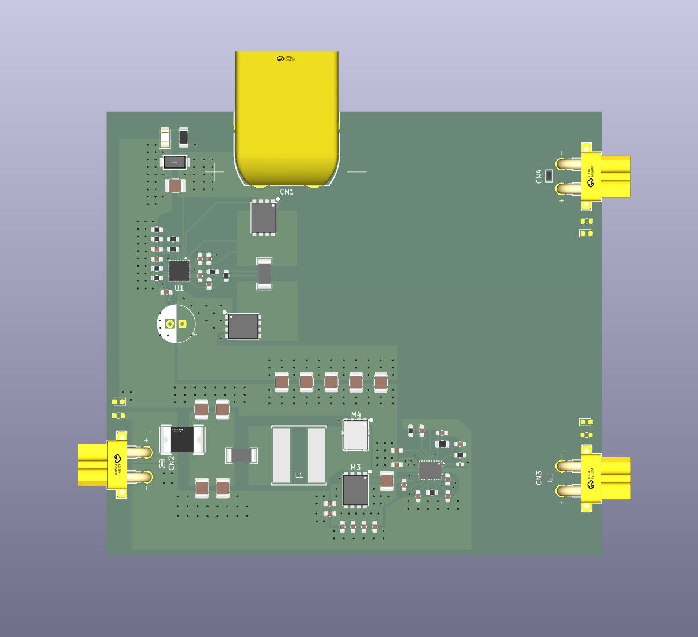
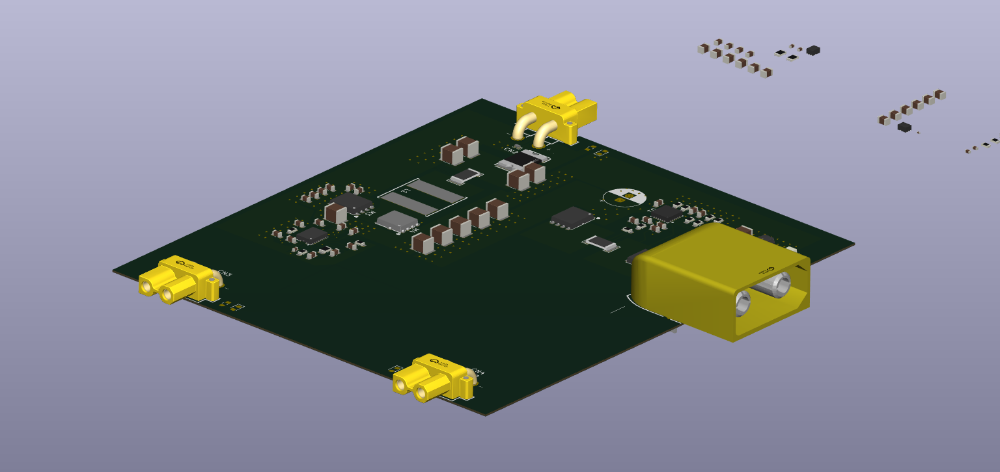

<div align="center">

# CARL PCB Design

<p align="center">This repository holds all PCB projects as they pertain to the Autonomous Systems Lab's CAR 1 Project.</p>

[](https://opensource.org/licenses/UNLICENSED)

</div>

---

## Power Distribution PCB Project

> A device that converts a 24V input source into 12V, 5V, and 3.3V outputs with appropriate circuit protections.  
> Authored by Bryan Luong, Jonathan Villalobos    
> Designed in Kicad





## Installation

```bash
git clone https://github.com/IzAKuLuS/CARL_PCB_Design.git
cd CARL_PCB_Design
git checkout powerDistribution
```

## License

Distributed under the UNLICENSED License. See `LICENSE` for more information.

---

<div align="center">Made by the Autonomous Systems Laboratory</div>
